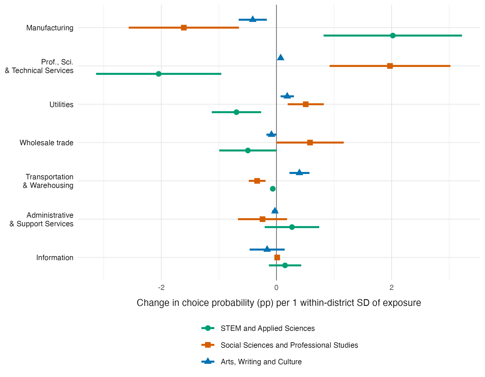
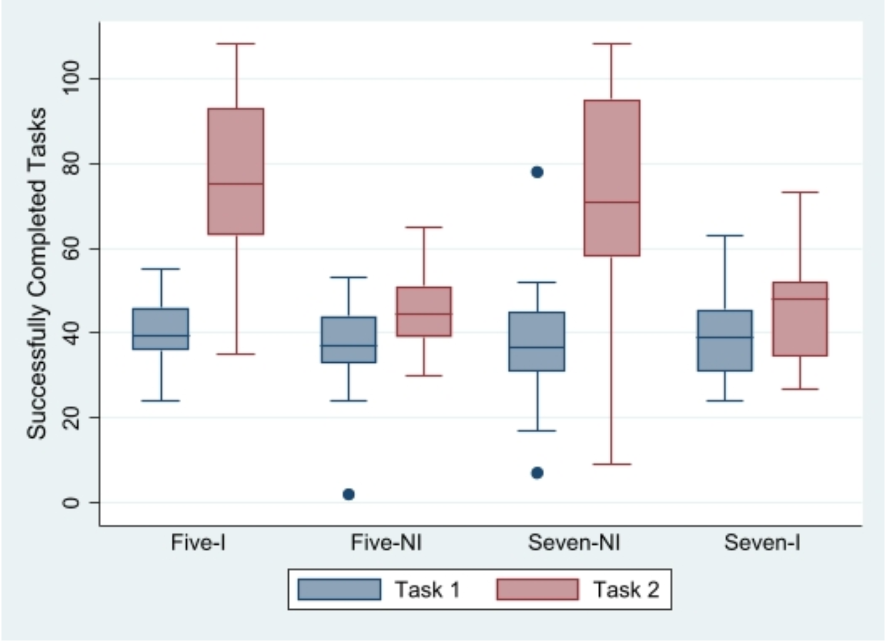
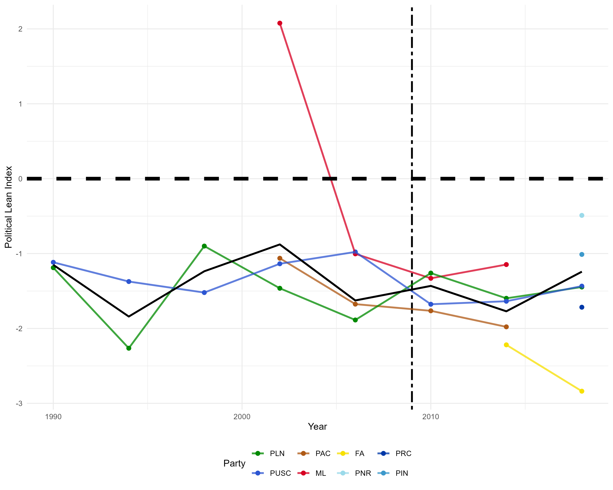

[Research Statement](files/documents/research-statement.pdf){target=_blank .btn .btn-primary .btn-lg .cv-download}

## Job Market Paper

[Latest Draft (11.01.2026)](files/documents/JMP-Manuscript.pdf){target=_blank .btn .btn-primary .btn-lg .cv-download} 
<!-- [Presentation](presentation/JMP/00-slides-compilation.html){target=_blank .btn .btn-primary .btn-lg .cv-download} -->

:::: {.columns}

::: {.column width="55%"}
[Global Firms, Local Students:  
Multinational Presence Shapes College Major Choice]{.header-large}

Multinational firms reshape local labor demand and the returns to skill acquisition. 
I document an additional channel through which they shape human capital formation: students choose different fields of study before entering the labor market. 
Combining administrative records from a large public university in Costa Rica with firm-level data on free trade zone establishments, I construct a measure of local multinational presence that weights firms by their distance to each applicant’s district of residence and by how intensively each industry hires from each field of study. 
Estimating a conditional logit with district and year fixed effects and district-clustered standard errors, I find that a one standard deviation increase in within-district manufacturing exposure raises the probability of choosing STEM by 2.0 percentage points, five percent of the baseline rate, drawing students from social sciences and professional studies. 
Service-sector presence moves students in the opposite direction, a pattern difficult to reconcile with exposure proxying for local economic development.
Women respond 62 percent more strongly than men to manufacturing presence, narrowing the 18 percentage point gender gap in STEM enrollment. 
The composition of inward FDI, not only its volume, shapes the skills a country’s graduates acquire.
:::

::: {.column width="45%"}

 

{fig-align="right" width=500px height=400px}

:::

::::

## Publications

:::: {.columns}

::: {.column width="50%"}
[Wage Differences Matter: An Experiment of Social Comparison and Effort Provision when Wages Increase or Decrease]{.header-large}

[Games (2020), 11(4):59](https://www.mdpi.com/2073-4336/11/4/59){target=_blank} with [J. Forrest Williams](https://www.pdx.edu/economics/j-forrest-williams){target=_blank}

Wage rates, efficiency wages, and gift exchange in a labor market are all crucial aspects
in regard to designing contracts to ensure high effort from workers. We extend this literature by
discussing the relationship between known differences in wages (social comparison) and workers’
effort provision. We conduct an experiment in which subjects perform effort tasks for piece-rates.
All subjects are paid the same wage rate in the first half of the experiment, but in the second half are
paid different wage rates; the primary variable we study is the information about others’ wage rates
given to a subset of subjects. We find that subjects’ efforts respond strongly to information about
others’ wages. Such findings have implications for contract structuring for workers.
:::

::: {.column width="50%"}

 

{fig-align="right" width=500px height=400px}

:::

::::

## Working Papers

:::: {.columns}

::: {.column width="60%"}
[Does The Global South Import Ideology Shifts?]{.header-large}

Previous research has shown that regions negatively impacted by trade have shifted toward political extremes in developed nations. 
The developing world has largely gone overlooked in this realm. 
Looking at Costa Rica, a developing nation with a stable democracy and who ratified CAFTA-DR in 2009, I use canton-level vote shares and political party manifesto data to estimate political ideology at the canton-level across elections. 
Using change in imports by election cycle, I use a shift-share analysis to estimate import competition experienced in Costa Rica. 
Results show that increased exposure to import competitions shifts political support toward relatively right-leaning political parties. 
Decomposing political ideologies into social and economic dimensions suggests that the observed shift is driven by social policies, by as much as three times than economic policies. 
This finding provides evidence of links between adverse economic shocks to ideological shifts within developing nations. 

[Paper Draft](files/documents/CAFTA-Manuscript.pdf){target=_blank .btn .btn-primary .btn-lg .cv-download} 

:::

::: {.column width="40%"}

 

{fig-align="right" width=450px height=300px}

:::

::::

## Works in Progress

[Theory Model of Multinational Firm Presence on College Major Choice]{.header-large}

::: {.callout-tip appearance="minimal" collapse="true"}
### Project Description

This paper develops a general equilibrium model of how multinational entry reshapes the skill composition of a developing economy's future workforce.
Students choose fields by multinomial logit over expected earnings, multinational firms choose locations by conditional logit over local wages and skilled labor availability, and a field-industry attachment matrix links industry-level foreign investment to field-level labor demand. 
Equilibrium is a fixed point in log wages that closes the feedback loop from student specialization to graduate stocks to wages. 
I characterize existence, provide conditions for uniqueness, and show that the wage response to multinational exposure is signed and amplified by a multiplier. 
Because students internalize neither the crowding of their chosen field nor its pull on subsequent firm entry, the allocation is generically inefficient; I characterize the taxes and subsidies that restore efficiency. 
The framework gives the structural interpretation of the reduced-form estimates in `Global Firms, Local Students'.
:::

[Environmental Policy and FDI Type]{.header-large}

::: {.callout-tip appearance="minimal" collapse="true" .smaller}
### Project Description

In recent decades, environmental policy has shifted from the margins of economic policy to its center across nations. 
All parties to the Paris Agreement (2015) now have at least one law that addresses climate change.
Additionally, the Climate Change Laws of the World database holds more than 5,000 climate laws and policies worldwide.
The OECD's Environmental Policy Strigency Index (EPSI) rose by nearly 348\% across member countries from 1990 to 2020.
Crucially to international trade considerations, environmental regulation has found a place within trade and foreign investment itself. 
The average number of environmental provisions per preferential trade agreement rose from about eight in the 1990s to over 44 in the 2010s OECD (2025).
Yet, despite this sustained trend, the literature on how environmental regulation shapes FDI modes is still in its nascent stages.
Greenfield projects and cross-border M\&As face different regulatory exposure; 
new plants must satisfy current standards fully, whereas M\&A facilities often benefit from grandfathering, with compliance costs baked into the purchase price.
Their is significant variance across the world as individual nations with their own incentives and contexts seek out foreign capital investments.
Stringency in the host country should not only deter FDI, but reallocate its mode.
Coupled with an increasingly integrated global market, understanding what determines the choice between greenfield investments versus cross-border M\&A's is important not only for guiding the new economic theories of multinational corporations, but also for policy-makers.
:::

[MEX-US Immigration Modeled as a Heat Diffusion Equation]{.header-large}

::: {.callout-tip appearance="minimal" collapse="true"}
### Project Description

This paper provides a single coherent model that fully traces the journey of Mexican immigrants into the US. 
The model encompasses the push factors of emigration, the border crossing, and settlement in the United States.
I adapt a convection-diffusion equation from physics to model immigrant flows as a density field that evolves continuously across space and time. 
Migrant flows spread, drift toward opportunity, face attrition through immigration enforcement, and accumulate within ethnic enclaves.
The framework integrates two spatial regimes: a corridor model that captures pre-border dynamics in Mexico, and a two-dimensional diffusion system that captures post-entry settlement across the US. 
The border connects both regimes through an enforcement-dependent permeability condition. 
I estimate the full parameter vector, which includes wage-gap elasticity, enforcement elasticity of crossing probability, and a network elasticity of interior diffusivity.
This is simulated using a method of moments approach, matching county-year density moments to the American Community Survey data. 
The estimated model may generate counterfactual predictions for the entire spatial distribution of immigrants under alternative enforcement regimes and labor market conditions, yielding spatial general equilibrium effects that reduced-form designs cannot produce.

:::

<!-- [eDACAtion: Are Higher Education Attainment Benefits Equally Distributed Amongst Undocumented Youth?]{.header-large}

::: {.callout-tip appearance="minimal" collapse="true"}
### Project Description

The objective of this course is to provide you with an introduction to, and overview of, the most important concepts in microeconomics.
The material in this course provides the foundation for studying issues in a wide variety of fields in economics, including international trade, labor, development, and other fields, and is essential for further study in economics. 

Building off of basic microeconomic concepts, students will develop the ability to examine models of agents' decisions, including consumer utility maximization, firm profit maximization, and market equilibria. 
Most importantly, students will develop the ability to perform constrained optimization in both the economic and critical thinking sense.

::: -->

[Upward Language Mobility - Immigrant Children Learning English]{.header-large}

::: {.callout-tip appearance="minimal" collapse="true"}
### Project Description

This project studies a "down-up" (spill-up) language channel: 
whether first-generation immigrant children's English acquisition benefits their non-English-speaking parents and households. 
The mechanism is children acting as translators/interpreters, potentially raising parental English take-up, community and institutional engagement, and health or labor outcomes. 
Identification uses the No Child Left Behind Act (2001) as an exogenous shock mandating ESL instruction and EL accountability in all public schools, generating pre/post variation. 
Data would come from longitudinal immigrant surveys (MMP, LAMP, NIS, ECLS, NLSY97), with household language use as the proficiency proxy. 
The specification includes demographic controls plus location and household-time fixed effects.

:::

[Value of an MLB Arbitration Year]{.header-large}

::: {.callout-tip appearance="minimal" collapse="true"}
### Project Description

Major League Baseball's service-time rules create a period of near-monopsony pricing in which player compensation is administratively set well below marginal product.
This project would seek to estimate the value of a pre-arbitration year, in both dollars and expected Wins Above Replacement (WAR), and asks how that value is capitalized into team decisions. 
The approach recovers an implicit price per win from free-agent contracts, then compares it to observed pre-arbitration salaries to construct surplus value per year of control.
Pre-arbitration performance also carries option value, since it forecasts arbitration awards and free-agen earnings. 
The difference between realized surplus and its ex-ante expectation identifies how much of a prospect's value is speculative. 
Because years of control are a tradable asset, team behavior (promotion timing, trade returns, and extension offers) reveals whether front offices price control consistently with these estimates. 
All proposed data are publicly available or scrapable from standard baseball statistic sources.
:::

[National Soccer Leagues Success and National Team Performance]{.header-large}

::: {.callout-tip appearance="minimal" collapse="true"}
### Project Description

This project asks whether the success of a countrys top domestic clubs translates into national team performance, and if so, through what channel. 
The central hypothesis is that team-level complementarities, such as familiarity among players who share club minutes, tactical systems, and coaching, contribute more to national team output than the sum of individual talent. 
I proxy individual quality with transfer market valuations and observed transfer feeds, club quality with domestic league standings and results in continental competitions, and cohesion with concentration of the national squad across domestic clubs and shared minutes played. 
Outcomes may include Elo ratings, qualification outcomes, and match-level results. 
Because squad concentration is mechanically higher where the domestic talent pool is thin, effects should be largest among lower-ranked federations, which offers a natural hetergoeneity test. 
The main empirical challenge is reverse causality, where strong players raise both club and national performance simultaneously. 
Continental competition qualification cutoffs and the timein of club-level financial shocks provide plausible sources of variation in club quality that are unrelated to contemporaneous national squad talent.

:::